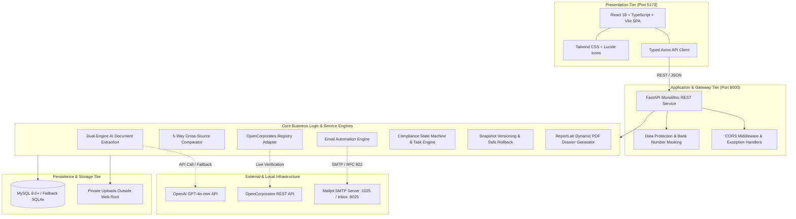

# VendorVerify AI – Architecture Explanation

## 1. Executive Summary

**VendorVerify AI** is an enterprise-grade autonomous vendor onboarding and compliance verification platform. It solves the operational bottlenecks and fraud risks inherent in manual vendor verification by combining:
- **Dual-Engine AI Document Extraction**: Extracts entity details from certificates and statements using OpenAI GPT-4o-mini with an automated deterministic regex/NLP fallback.
- **5-Way Deterministic Comparator Matrix**: Cross-references vendor profile input, Certificate of Incorporation, GST Registration (REG-06), Bank Verification Statement, and official corporate registry APIs.
- **Corporate Registry Authentication**: Verifies legal entity identity, jurisdiction, and active standing via the OpenCorporates REST API.
- **Automated Email Dispatch**: Triggers real-time alerts for missing documents and compliance status changes via Mailpit SMTP (`localhost:1025`) and Resend API.
- **Immutable Snapshot Versioning & 1-Click Rollback**: Tracks exact JSON diffs on every profile update and enables safe state restoration without breaking audit trails.

---

## 2. High-Level Architecture Diagram

---

## 3. Subsystem Breakdown

### 3.1 Frontend Presentation Tier
- **Framework**: React 18 with TypeScript 5.4, Vite 5, Tailwind CSS 3.4.
- **Component Architecture**: Modular layout (`MainLayout`, `Navbar`, `Sidebar`, `StatusBadge`, `MaskedValue`, `ConfirmModal`).
- **Data Protection**: Bank accounts are displayed masked by default (`********1234`) with on-demand authorized disclosure toggle.
- **Audit Views**: Multi-tab workspace showing Vendor Overview, Uploaded Documents with quoted snippets, 5-Way Comparison Matrix, OpenCorporates Registry status, Remediation Tasks, and Version History diffs.

### 3.2 FastAPI REST Backend Tier
- **Framework**: FastAPI (Python 3.12+) using asynchronous route handlers and Pydantic V2 validation schemas.
- **Modular Routers**:
  - `/api/vendors`: CRUD operations, search, filtering, and masking logic.
  - `/api/documents`: File upload validation, MIME checking, and secure storage.
  - `/api/verification`: 5-way comparator execution and discrepancy resolution.
  - `/api/workflow`: State machine transitions, gate checks, and missing document triggers.
  - `/api/tasks`: Compliance auditor task lifecycle management.
  - `/api/versions`: Snapshot diffing and safe historical state restoration.
  - `/api/samples`: Pre-packaged fake enterprise PDF generation and 1-click test suites.

### 3.3 Relational Persistence Tier
- **Database Engine**: MySQL 8.0+ connected via PyMySQL and SQLAlchemy 2.0.
- **Fail-Safe Mechanism**: Automatic fallback to SQLite (`sqlite:///./vendorverify.db`) if MySQL is not detected, enabling instant zero-config startup.
- **Relational Integrity**: 11 normalized tables with cascading foreign keys:
  - `vendors`, `documents`, `document_extractions`, `field_comparisons`, `company_verifications`, `document_checklists`, `tasks`, `vendor_versions`, `workflow_history`, `email_notifications`.

### 3.4 Dual-Engine AI Document Processing
- **Primary Engine**: OpenAI GPT-4o-mini structured JSON extraction with system prompts requiring confidence scoring (`0.0`–`1.0`) and source citations.
- **Fallback Engine**: Local smart regex & NLP parser that extracts Company Name, CIN, GSTIN, Address, Bank Account, and IFSC code with zero external dependencies.
- **Auditor Override**: Manual reviewer corrections are tracked separately (`is_user_corrected=True`), preserving the original AI extraction for auditing.

### 3.5 5-Way Deterministic Comparator Matrix
- Compares data across:
  1. Vendor Input Record
  2. Certificate of Incorporation
  3. Form GST REG-06
  4. Commercial Bank Document
  5. OpenCorporates Corporate Registry
- **Entity Normalization**: Handles case insensitivity, whitespace collapsing, and corporate suffix standardization (`Pvt Ltd` $\leftrightarrow$ `Private Limited`).
- **Badging**: Color-coded `MATCH` (Green), `MISMATCH` (Red), and `MISSING` (Amber) statuses with human-readable explanations.

### 3.6 Corporate Registry Verification
- **Adapter**: Connects to OpenCorporates API to verify legal entity names, active status, and jurisdictions.
- **Fault-Tolerant Design**: Network errors, rate limits, or timeouts default to `UNABLE_TO_VERIFY` and do not invalidate the vendor record.

### 3.7 Email Automation & Mailpit
- **Delivery**: Dispatches automated RFC 822 MIME emails directly over SMTP to Mailpit on `localhost:1025`.
- **Triggers**:
  - Missing document detection triggers an action-required email notice.
  - Workflow state changes (`APPROVED`, `REJECTED`, `ACTION_REQUIRED`) dispatch status alerts.
- **Inspection**: Reviewers inspect all delivered emails in the Mailpit web UI on `http://localhost:8025`.
- **Audit Logging**: Every dispatched email is logged in the `email_notifications` table with status and timestamps.

### 3.8 Workflow State Machine & Approval Gates
- **Lifecycle States**: `DRAFT` $\rightarrow$ `UNDER_REVIEW` $\rightarrow$ `ACTION_REQUIRED` $\rightarrow$ `APPROVED` / `REJECTED`.
- **Strict Approval Gates**: Prevents moving to `APPROVED` if mandatory documents are missing or if open high-priority discrepancy remediation tasks remain unresolved.

### 3.9 Snapshot Versioning & Safe Rollback
- Every vendor edit automatically serializes the previous state into a JSON snapshot in `vendor_versions`.
- Visual diffs highlight exact modified fields.
- 1-Click restoration re-applies historical data while appending a new version record to preserve an immutable audit trail.

---

## 4. Security & Compliance Highlights

1. **Banking Data Privacy**: Bank account numbers are masked (`********1234`) at the schema serialization level, preventing accidental leaks in logs and UI.
2. **File Safety**: Uploads are restricted by MIME type (`application/pdf`, `image/png`, `image/jpeg`) and file size, and saved outside web roots with sanitized filenames.
3. **Auditing**: Every workflow transition, discrepancy override, and version restoration records the timestamp, actor, and reason.
