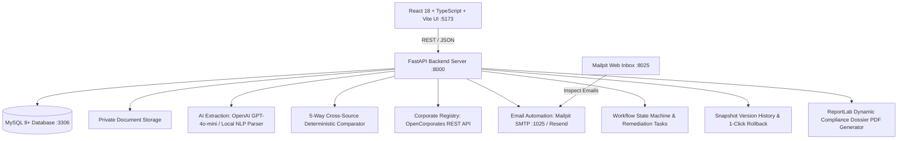

# VendorVerify AI – Intelligent Vendor Verification & Compliance Workspace

[](https://www.python.org/)
[](https://fastapi.tiangolo.com/)
[](https://reactjs.org/)
[](https://www.typescriptlang.org/)
[](https://www.mysql.com/)
[](https://tailwindcss.com/)
[]()
[](https://www.docker.com/)

> **Autonomous Enterprise Vendor Onboarding, Multi-Document Entity Extraction with Dual-Engine AI, 5-Way Cross-Source Discrepancy Auditing, OpenCorporates Registry Verification, and Email Automation.**

---

## Executive Summary

Manual vendor compliance and onboarding in enterprise procurement is traditionally slow, error-prone, and susceptible to invoice and identity fraud. Companies must manually cross-reference Certificates of Incorporation, tax documents (GST/PAN), and banking records against corporate registries.

**VendorVerify AI** automates this entire lifecycle into an intelligent, auditor-friendly command center:
1. **Dual-Engine Entity Extraction**: High-precision parsing via OpenAI GPT-4o-mini with deterministic local regex/NLP fallback for zero-dependency operation.
2. **5-Way Cross-Document Comparator**: Performs automated cross-checking across Vendor Input, Certificate of Incorporation, GST REG-06 Certificate, Bank Verification Certificate, and official corporate registry APIs.
3. **Corporate Registry Integration**: Connects with OpenCorporates to authenticate legal entity names, active status, jurisdiction, and incorporation numbers.
4. **Compliance Automation & Notice Dispatch**: Automatically detects missing documents, flags discrepancies, triggers email notices via Resend/SMTP, and logs auditor remediation tasks.
5. **Auditor Workspace & Safe Version Rollback**: Full snapshot versioning with visual JSON diffs, sensitive banking number masking (`********1234`) with authorized on-demand disclosure, and certified compliance dossier PDF exports.

---

## System Architecture



---

## How to Run on Your Computer (Step-by-Step)

### Prerequisites
Make sure you have installed:
- **Git**: [git-scm.com](https://git-scm.com/)
- **Python 3.12+**: [python.org](https://www.python.org/)
- **Node.js 18+ and npm**: [nodejs.org](https://nodejs.org/)
- **Docker & Docker Desktop** *(for Mailpit & MySQL containers)*: [docker.com](https://www.docker.com/)

---

### Step 1: Clone the Repository

```bash
git clone <repository-url>
cd vendorverify-ai
```

---

### Step 2: Start Mailpit (Email Service) & Database

Mailpit receives all automated onboarding & missing document emails on SMTP port `1025` and provides a web inbox at `http://localhost:8025`.

Run Mailpit using Docker:
```bash
docker run -d --name vendorverify-mailpit -p 1025:1025 -p 8025:8025 axllent/mailpit:latest
```
*(Optional) If you have MySQL installed locally on port 3306, create the database:*
```sql
CREATE DATABASE IF NOT EXISTS vendorverify;
```
> **Note:** If MySQL is not running, the backend automatically falls back to an embedded SQLite database (`vendorverify.db`) so the application will run without any database setup!

---

### Step 3: Configure and Start the Backend

1. Navigate to the `backend` directory:
   ```bash
   cd backend
   ```

2. Copy the environment variables:
   ```bash
   cp .env.example .env
   # On Windows PowerShell:
   # Copy-Item .env.example .env
   ```

3. Install Python dependencies:
   ```bash
   pip install -r requirements.txt
   ```

4. Start the FastAPI backend server:
   ```bash
   python -m uvicorn app.main:app --host 0.0.0.0 --port 8000 --reload
   ```

- Backend Health Check: [http://localhost:8000/health](http://localhost:8000/health)
- Interactive Swagger API Documentation: [http://localhost:8000/docs](http://localhost:8000/docs)

---

### Step 4: Start the Frontend

Open a **new terminal window**:

1. Navigate to the `frontend` directory:
   ```bash
   cd frontend
   ```

2. Install npm dependencies:
   ```bash
   npm install
   ```

3. Start the Vite development server:
   ```bash
   npm run dev
   ```

4. Open the application in your browser:
   👉 **[http://localhost:5173](http://localhost:5173)**

---

### Alternative: 1-Command Startup with Docker Compose

You can also run the entire stack (Database, Backend, and Frontend) in one command:
```bash
docker compose up --build
```
- Frontend UI: [http://localhost:5173](http://localhost:5173)
- Backend API: [http://localhost:8000](http://localhost:8000)

---

## Verification & Testing

### 1. Run Automated Test Suite (Pytest)
```bash
cd backend
pytest -v
```
All 7 assessment scenarios pass:
- **Scenario A**: Full onboarding, document ingestion, AI extraction, OpenCorporates verification, and clean approval.
- **Scenario B**: Missing document detection, transition to `ACTION_REQUIRED`, compliance task creation, and automated email notice dispatch.
- **Scenario C**: Legal name mismatch detection, discrepancy flagging, and strict approval blocking.
- **Scenario D**: Snapshot diff tracking upon profile changes and 1-click safe rollback.
- **Scenario E**: External registry API timeout handling without invalidating vendor records.
- **Scenario F**: File upload security, size restrictions, and path traversal protection.
- **Scenario G**: Sensitive banking number masking (`********1234`) and authorized disclosure.

### 2. Run End-to-End Verification Script
An end-to-end automated script exercises all 6 core modules in sequence:
```bash
python verify_all.py
```
This script creates a vendor, extracts entities from sample PDFs, queries OpenCorporates, sends a missing documents email to Mailpit, checks delivery on Mailpit's REST API, runs the 5-way comparator, and performs a version rollback.

### 3. Check Mailpit Web Inbox
Open **[http://localhost:8025](http://localhost:8025)** in your browser to inspect all sent compliance notices, missing documentation alerts, and onboarding emails in real-time.

---

## Demonstration Suite: 3 Separate Companies & Fake PDFs

The platform includes a pre-packaged suite of **3 separate enterprise companies**, each equipped with its own distinct, professionally generated compliance certificates (Registration Certificate, Form GST REG-06, and Commercial Bank Statement):

| Company | CIN / Registration | GSTIN | Bank Account / IFSC | Compliance Scenario |
| :--- | :--- | :--- | :--- | :--- |
| **1. Zenith Cloud Technologies Pvt Ltd** | `U72200KA2020PTC138890` | `29AAACZ1234F1Z5` | `98765432101234`<br>`HDFC0001234` | **100% PERFECT MATCH**<br>All 3 documents, profile values, and registry API match identically with 0 discrepancies (Auto-Approved). |
| **2. Nexus Enterprise Solutions Pvt Ltd** | `U72900DL2021PTC345678` | `07AABCN5678M1Z9` | `40987654321098`<br>`ICIC0000045` | **100% PERFECT MATCH**<br>Separate enterprise entity with full 3-document suite; verified match across all events. |
| **3. Apex Logistics & Supply Chain Pvt Ltd** | `U63090MH2019PTC234567` | `27AAACA9876P1Z4` | `60234567890123`<br>`KKBK0000456` | **100% PERFECT MATCH**<br>Separate logistics enterprise with 3 separate fake PDFs; 100% verified match across all events. |

### Edge-Case Testing Companies:
- **ABC Technologies Pvt Ltd**: Demonstrates **Discrepancy / Mismatch Flow** (Legal name difference between GST Certificate and Incorporation Certificate triggers `ACTION_REQUIRED` and auto-creates reviewer tasks).
- **Vertex Logistics Pvt Ltd**: Demonstrates **Missing Document Flow** (Missing Bank Statement triggers automated client email notice and compliance hold).

All 9 fake PDFs can be previewed or downloaded directly from the UI or via API:
`GET /api/samples/download/{company_key}/{doc_type}`

---

## 5-Minute Evaluator Walkthrough

1. **Open Dashboard**: Go to [http://localhost:5173](http://localhost:5173).
2. **Download Architecture Report PDF**: Click **"Download Report PDF"** in the top navbar.
3. **1-Click 100% Match Seed**:
   - Click the green **"1-Click 100% Match"** button in the navbar.
   - The platform auto-creates Zenith Cloud, uploads all 3 fake PDFs, extracts entities, queries OpenCorporates, and verifies 0 discrepancies.
4. **Inspect the Vendor Workspace (`/vendors/{id}`)**:
   - **Overview**: View masked bank account (`********1234`) with click-to-unmask toggle.
   - **Documents**: Inspect uploaded certificates with extraction confidence ratings (**96%**) and quoted text citations.
   - **AI Comparison Matrix**: View the 5-way comparison with green `MATCH` badges.
   - **Corporate Registry**: Verify the OpenCorporates status (`Active`, jurisdiction: `in`).
   - **Version History**: Edit a field, view the JSON diff, and test **"Restore This Version"** for safe rollback.
   - **Download Compliance Dossier**: Click **"Download Compliance Dossier PDF"** to export the dynamic certified ReportLab audit report.
5. **Check Mailpit**: Go to [http://localhost:8025](http://localhost:8025) to view all captured notification emails.

---

## Key API Endpoints Reference

| Module | Method | Endpoint | Description |
| :--- | :--- | :--- | :--- |
| **System** | `GET` | `/health` | System health check and service status |
| **Reports** | `GET` | `/api/samples/download-report` | Guaranteed delivery of Architecture Build Report PDF |
| **Samples** | `GET` | `/api/samples/files` | Lists all 3 companies and their separate fake PDFs |
| **Samples** | `GET` | `/api/samples/download/{company}/{type}` | Downloads specific company fake PDF |
| **Samples** | `POST` | `/api/samples/seed-company-1` | Seeds Zenith Cloud (100% Perfect Match) |
| **Samples** | `POST` | `/api/samples/seed-all-companies` | 1-Click seed for all 3 separate companies |
| **Vendors** | `GET` | `/api/vendors` | List vendors with search, filter, and pagination |
| **Vendors** | `POST` | `/api/vendors` | Onboard new vendor profile |
| **Vendors** | `GET` | `/api/vendors/{id}` | Retrieve vendor details (supports `?unmask=true`) |
| **Documents** | `POST` | `/api/vendors/{id}/documents` | Upload compliance PDF & trigger AI extraction |
| **Comparison**| `POST` | `/api/vendors/{id}/compare` | Run deterministic 5-way cross-source comparison |
| **Registry** | `POST` | `/api/vendors/{id}/verify-company` | Query OpenCorporates registry adapter |
| **Workflow** | `PATCH`| `/api/vendors/{id}/workflow` | Transition lifecycle state (`DRAFT` → `APPROVED`) |
| **Dossier** | `GET` | `/api/vendors/{id}/dossier-pdf` | Export certified dynamic compliance dossier PDF |

---

## Project Structure

```text
vendorverify-ai/
├── backend/
│   ├── app/
│   │   ├── api/routes/        # vendors, documents, verification, workflow, tasks, versions, samples
│   │   ├── core/              # config, logging, security
│   │   ├── database/          # connection, base
│   │   ├── models/            # SQLAlchemy models (Vendor, Document, Extraction, Workflow, Tasks)
│   │   ├── schemas/           # Pydantic V2 validation schemas
│   │   ├── services/          # AI extraction, comparison, OpenCorporates, email, dossier PDF services
│   │   └── main.py            # FastAPI entry point & exception handlers
│   ├── migrations/            # Alembic database migrations
│   ├── sample_documents/      # 3 separate companies fake PDFs & Architecture report
│   ├── tests/                 # pytest test suite
│   ├── requirements.txt
│   └── Dockerfile
├── frontend/
│   ├── src/
│   │   ├── api/               # Typed Axios client
│   │   ├── components/        # Navbar, Sidebar, StatusBadge, MaskedValue, ConfirmModal
│   │   ├── pages/             # Dashboard, VendorList, VendorForm, VendorDetail, TaskManagement
│   │   ├── types/             # TypeScript interfaces
│   │   ├── App.tsx
│   │   └── index.css
│   ├── package.json
│   └── vite.config.ts
├── docker-compose.yml
├── verify_all.py              # End-to-end automated verification script
└── README.md
```
